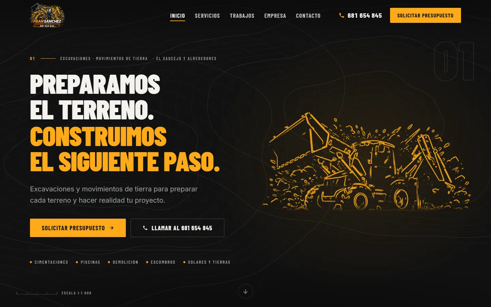
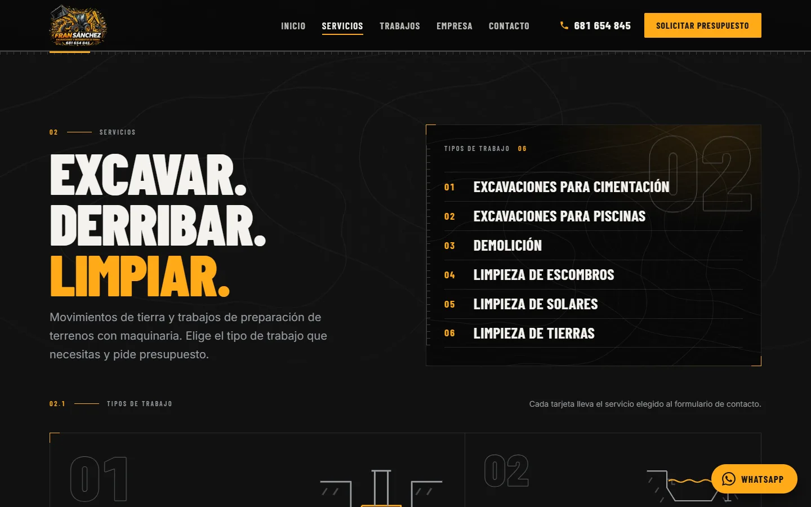
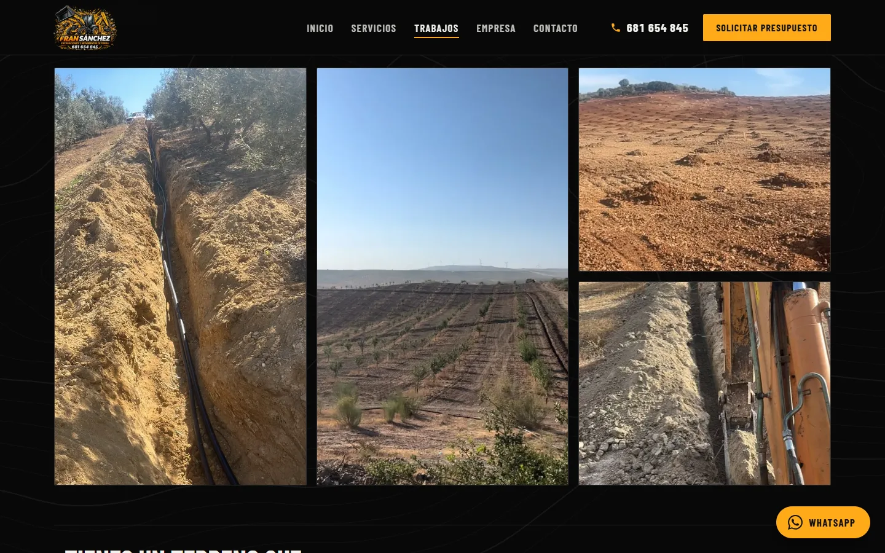
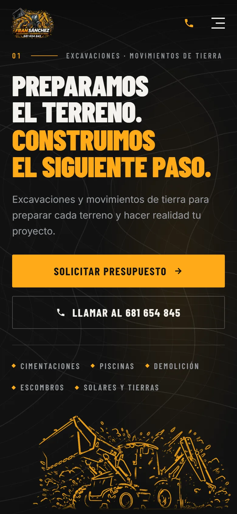

# Fran Sánchez Excavaciones y Movimientos de Tierra

Web corporativa real de un autónomo de excavaciones y movimientos de tierra en **El Saucejo (Sevilla)**,
diseñada y desarrollada de principio a fin: dirección de arte, componentes, SEO local, accesibilidad y despliegue.

**Web en producción: [www.excavacionesfransanchez.com](https://www.excavacionesfransanchez.com)**



| Servicios | Trabajos | Contacto |
| --- | --- | --- |
|  |  |  |

<p align="center"></p>

## Qué incluye

- **Diseño propio y coherente:** sistema de tokens CSS (color, tipografía fluida, espaciado, movimiento), tipografía
  condensada industrial, lenguaje visual de plano técnico y composición específica para móvil (no es el escritorio encogido).
- **Rendimiento:** HTML prerenderizado en el build (SSG de una ruta + hidratación), fuentes autoalojadas con precarga,
  imágenes AVIF/WebP con `srcset`, GSAP cargado en diferido, sin peticiones a terceros. JavaScript inicial ≈ 91 KB comprimido.
- **SEO local:** `<title>`, descripción, Open Graph y JSON-LD (`LocalBusiness`) generados desde los datos reales
  (`src/data`), sitemap, `robots.txt` y `llms.txt` en el build.
- **Accesibilidad:** HTML semántico, foco visible, navegación completa por teclado, menú móvil y diálogos con foco atrapado,
  `prefers-reduced-motion` respetado y contraste AA.
- **Conversión sin backend:** el formulario valida y abre WhatsApp con el mensaje ya escrito, o permite llamar.
  Nunca simula un envío.
- **Honestidad del contenido:** solo datos acreditados; las secciones sin material (reseñas, cifras) no se rellenan con inventos.

Lighthouse (build de producción en local, throttling simulado): **móvil 93 · escritorio 99** en rendimiento y
**100** en accesibilidad, buenas prácticas y SEO. Son mediciones locales, no de campo.

## Stack

React 19 · TypeScript 6 · Vite 8 · GSAP (ScrollTrigger, carga diferida) · CSS plano por componente · oxlint ·
GitHub Actions (lint + build) · Vercel.

<details>
<summary>English summary</summary>

Production website for a self-employed excavation contractor in El Saucejo (Seville, Spain). Built with React 19, TypeScript and
Vite 8; prerendered at build time, locally-optimised SEO (JSON-LD, sitemap, Open Graph), accessible by keyboard and
screen reader, ~91 KB gzipped initial JS, and a contact flow that opens WhatsApp with a prefilled message instead of
relying on a backend. Lighthouse (local, simulated throttling): mobile 93 / desktop 99, accessibility, best practices and SEO 100.

</details>

> Logotipo, textos y fotografías de trabajos pertenecen al cliente. El código se publica como muestra de trabajo.

## Cómo ejecutarla

Requiere [Node.js](https://nodejs.org) (versión LTS reciente).

```bash
npm install        # solo la primera vez
npm run dev        # servidor de desarrollo con recarga en caliente
```

En Windows basta con hacer doble clic en `ABRIR-WEB.bat` (carpeta superior): lanza
`npm run dev -- --host 127.0.0.1 --port 3000 --strictPort` y abre
<http://127.0.0.1:3000>.

| Comando                | Qué hace                                                                             |
| ---------------------- | ------------------------------------------------------------------------------------ |
| `npm run dev`          | Servidor de desarrollo (sin prerender)                                               |
| `npm run build`        | Tipos (`tsc -b`) + build de producción en `dist/` + prerender del HTML              |
| `npm run build:cliente`| Igual, sin prerender (la web se monta solo en el navegador)                          |
| `npm run preview`      | Sirve `dist/` en local para probar la versión compilada                              |
| `npm run typecheck`    | Solo comprobación de tipos                                                           |
| `npm run lint`         | oxlint sobre el código fuente (ignora `dist`, `public`, `source-assets`)             |

`dist/` es una web estática: se puede subir a cualquier alojamiento estático.
Conviene que el servidor envíe los archivos de `dist/assets/` comprimidos (gzip o
brotli) y con caché larga (llevan hash en el nombre).

## Estructura

```
index.html              Esqueleto: iconos y marcador <!--SEO_TAGS--> (lo rellena vite.config.ts)
vite.config.ts          React + generación de SEO desde src/data + precarga de fuentes + sitemap
scripts/prerender.mjs   Tras el build, inyecta el HTML renderizado de <App /> en dist/index.html
.env.example            Variables de entorno admitidas (copiar a .env)
public/                 Archivos servidos tal cual (iconos, og-image, robots, imágenes)
source-assets/          Originales pesados y recursos retirados; no se publican
src/
  main.tsx              Entrada: fuentes autoalojadas, estilos globales e hidratación
  entry-server.tsx      Entrada de servidor (solo para el prerender)
  App.tsx               Composición: Header → secciones → Footer
  index.css             Sistema de diseño: tokens, tipografía, utilidades
  components/           Una sección o pieza por archivo (+ su CSS con prefijo propio)
  data/                 Contenido editable (empresa, servicios, trabajos, proceso, legal…)
  hooks/ lib/           Utilidades (reveal al hacer scroll, movimiento reducido, enlaces…)
```

Anclas de sección: `#inicio`, `#servicios`, `#trabajos`, `#empresa`, `#proceso`, `#contacto`.
Los textos legales se abren con `#privacidad`, `#aviso-legal` y `#cookies`.

## Sistema de diseño

Todo sale de los tokens de `src/index.css`; no se usan colores sueltos.

- **Color:** carbón `--color-carbon` (#111111, fondo), negro profundo `--color-deep`
  (#080808, paneles), amarillo maquinaria `--color-yellow` (#FFAA18, acento),
  blanco roto `--color-cream` (#F4F2ED, titulares) y gris acero `--color-steel`
  (#9A9EA4, texto secundario).
- **Tipografía:** titulares en Barlow Condensed (800/900, mayúsculas) y cuerpo en
  Inter Variable, ambas autoalojadas con `@fontsource` (no se contacta con Google Fonts).
  Tamaños fluidos con `--fs-*`.
- **Espaciado y forma:** `--space-*`, `--gutter`, `--section-y`, `--container`;
  radios casi rectos (`--radius-sm: 2px`).
- **Movimiento:** `--ease-out` y duraciones `--dur-fast` / `--dur` / `--dur-slow`
  (180 / 360 / 720 ms).
- **Lenguaje técnico:** etiquetas numeradas (`.eyebrow`), reglas con marcas de escala
  (`.tech-rule`), esquinas de registro (`.tech-frame`) y curvas de nivel (`.topo-bg`).

## Actualizar el contenido

Solo se muestran datos acreditados. Si un dato opcional no existe, la web lo oculta.

- **Servicios** — `src/data/servicios.ts`. Son exactamente seis: cimentación, piscinas,
  demolición y limpieza de escombros, solares y tierras. Se reflejan solos en la web, en el
  desplegable del formulario y en los datos estructurados (`vite.config.ts` los lee de aquí).
  No añadir otros sin confirmación del titular.
- **Fotos de trabajos** — `src/data/trabajos.ts` + `public/images/trabajos/`. Hay cuatro
  fotos reales (zanjas y retroexcavadora en olivares), también usadas en el hero. Los
  originales están en `source-assets/fotos-trabajos/`. Para añadir más: optimizarlas a
  WebP/AVIF y sumarlas a la lista (el archivo explica el formato paso a paso). Si la lista
  se vaciara, la sección vuelve a mostrar el índice de tipos de trabajo, sin galería falsa.
- **Cifras y credenciales** — `src/data/credenciales.ts`. Vacío por defecto; solo
  añadir lo que el titular confirme y pueda acreditar.
- **Datos de la empresa** — `src/data/empresa.ts`: teléfono, WhatsApp, `localidad`, `provincia` y `zonasActuacion`.
  Los datos personales del titular (nombre, NIF, domicilio) **no están en el código**: se leen de variables
  de entorno (`VITE_TITULAR_*`, ver `.env.example`) y solo se muestran en el aviso legal y la política de privacidad.
- **Proceso** — `src/data/proceso.ts`. **Textos legales** — `src/data/legal.ts`.

## Formulario de contacto: WhatsApp o llamada

No hay servidor ni servicio externo que configurar. El formulario tiene dos salidas:

1. **Enviar por WhatsApp:** valida los campos, compone un mensaje legible y abre
   `https://wa.me/34681654845?text=…` con el mensaje ya escrito; la persona solo tiene
   que pulsar «enviar» en WhatsApp. La web no guarda los datos y nunca dice «enviado»:
   avisa de que WhatsApp se ha abierto con el mensaje listo.
2. **Llamar** al 681 654 845 (`tel:`).

También hay botones flotantes de WhatsApp y llamada en toda la página. El número se
cambia en un solo sitio: `src/data/empresa.ts`.

## SEO

Qué hace el proyecto por el posicionamiento:

- **Prerender (`npm run build`):** el HTML de producción ya contiene todo el contenido,
  no solo un `<div id="root">` vacío; el navegador lo «hidrata» después. Los buscadores
  y las redes lo leen sin ejecutar JavaScript y el primer pintado es más rápido.
- **Metadatos generados desde los datos reales:** `<title>`, descripción, Open Graph,
  Twitter y JSON-LD (`LocalBusiness` + `GeneralContractor` con catálogo de los 10
  servicios, teléfono y punto de contacto). Sin inventar dirección, horario, precios ni zona.
- **Rendimiento (Core Web Vitals):** sin peticiones externas, fuentes autoalojadas con
  precarga de las críticas, fotos en AVIF/WebP con dos tamaños, imágenes con dimensiones y
  `fetchpriority` en la imagen principal, y GSAP en carga diferida.
- **Accesibilidad y estructura:** un solo `<h1>` (incluye nombre y actividad), jerarquía
  de encabezados, enlaces descriptivos, textos alternativos reales.

Para **aparecer antes en Google** hacen falta cuatro cosas que dependen del titular:

1. **Dominio** → `VITE_SITE_URL` en `.env` (genera canonical, sitemap y URLs absolutas).
2. **Zona de trabajo** → ya configurada (`localidad: El Saucejo`, `provincia: Sevilla`,
   `zonasActuacion`). Es lo que más pesa en búsquedas como «excavaciones en El Saucejo»:
   se añade automáticamente al título, la descripción, el hero, el pie y los datos
   estructurados. Si se quiere citar otros municipios, ampliar `zonasActuacion`.
3. **Google Search Console** → `VITE_GOOGLE_SITE_VERIFICATION`, y enviar el sitemap.
4. **Ficha de Empresa de Google (Google Business Profile)**, con el mismo nombre y
   teléfono que la web, fotos reales de las obras y reseñas de clientes. Es lo que
   decide la aparición en el mapa y en las búsquedas locales.

Variables admitidas (ver `.env.example`): `VITE_SITE_URL`, `VITE_GOOGLE_SITE_VERIFICATION`.

## Rendimiento y accesibilidad

- **Carga:** el hero usa tres fotos reales (AVIF con WebP de respaldo y versión móvil); el
  texto aparece sin esperar a ninguna librería. GSAP solo anima parallax suave y se descarga aparte.
- **Movimiento:** con «reducir movimiento» activado se desactivan el parallax y las
  animaciones de entrada; el contenido es completo.
- **Accesibilidad:** HTML semántico, enlace «saltar al contenido», foco visible, objetivos
  táctiles de al menos 44 px y navegación completa por teclado (menú móvil y diálogos
  atrapan el foco).
- No se han fijado métricas objetivo; mídelas con Lighthouse sobre
  `npm run build && npm run preview` antes de publicar.

## Créditos

- Fuentes: [Barlow Condensed](https://fontsource.org/fonts/barlow-condensed) e
  [Inter](https://fontsource.org/fonts/inter), licencia SIL OFL 1.1 (vía `@fontsource`).
- El logotipo ilustrado, los textos y las fotografías de trabajos son de la empresa. Los
  originales están en `source-assets/`.
- La versión con escena 3D (modelo «JCB Backhoe loader» de sarvesh12, CC BY 4.0) se
  retiró del proyecto; su código y modelos se conservan en `source-assets/3d-descartado/`.
  Si se volviera a usar ese modelo habría que volver a mostrar su atribución.

## Pendiente del titular

Datos que faltan para completar la web (hasta entonces no se muestran):

- Correo electrónico: opcional (el teléfono y el WhatsApp ya valen como medio de contacto directo).
- Dominio definitivo (`VITE_SITE_URL`) y verificación de Search Console.
- Cifras o credenciales que pueda acreditar (años de actividad, nº de obras, certificaciones).
- Revisión de los textos legales por el titular o su asesor.
- Más fotos reales de trabajos (cimentaciones, piscinas, demoliciones, limpiezas), con permiso para publicarlas.
